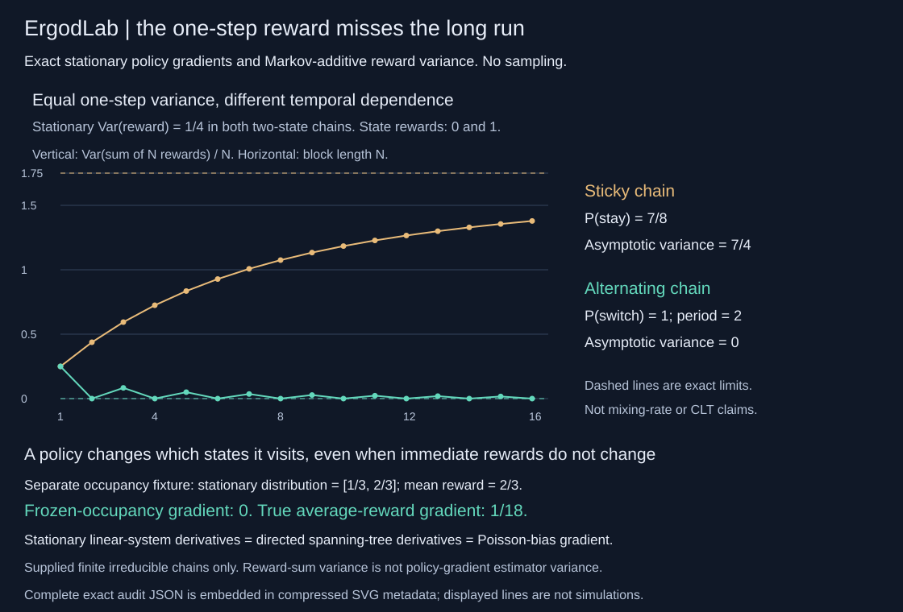
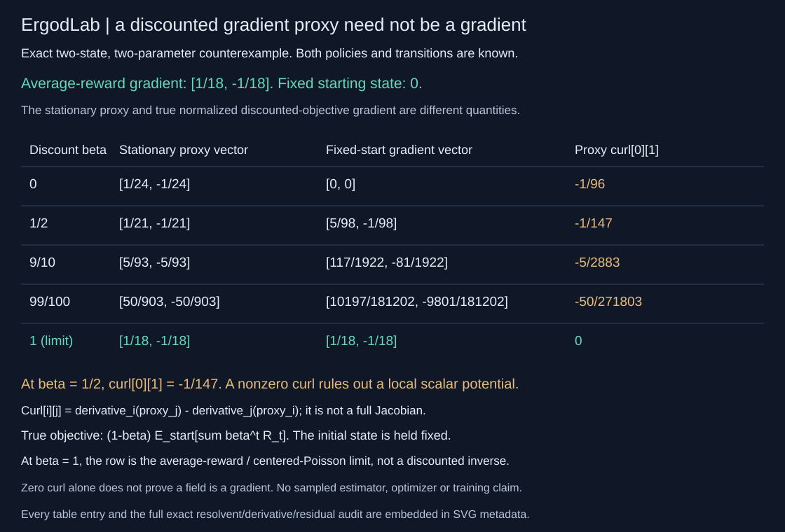

# ErgodLab

**A policy can change its long-run reward even when its immediate-reward gradient is zero.**

ErgodLab is a dependency-free, exact-rational laboratory for finite stationary policies. It differentiates the stationary distribution, cross-checks it against directed spanning trees, solves the Poisson bias equation, and audits the temporal variance of Markov-additive rewards. Every residual is returned. No simulation, fitted environment, paid API or external dataset.



## Two failures of a one-step view

### Freezing occupancy loses the gradient

The first fixture has two states with rewards 0 and 1, both actions equally likely, and one shared policy coordinate. In state 0, action 0 switches to state 1 with probability 1/4, action 1 with probability 3/4. In state 1, either action switches back with probability 1/4. Only the state-0/action-1 log-weight has feature 1.

At the anchor:

| Exact quantity | Value |
|---|---|
| Controlled transition | `[[1/2,1/2],[1/4,3/4]]` |
| Stationary distribution | `[1/3,2/3]` |
| Stationary derivative | `[-1/18,1/18]` |
| Average reward | `2/3` |
| Gradient with stationary occupancy frozen | `0` |
| True average-reward gradient | `1/18` |
| Centered Poisson bias | `[-8/9,4/9]` |

The immediate reward in each state is action-independent. The policy still changes how often the rewarding state is visited. The stationary derivative and Poisson-reference gradient agree exactly with an independent spanning-tree product-rule derivative.

### Identical one-step variance does not imply identical long-run variance

Two separate symmetric chains have state rewards 0 and 1 and stationary distribution `[1/2,1/2]`:

| Chain | Transition behavior | One-step stationary variance | Asymptotic reward-sum variance per step |
|---|---|---:|---:|
| Sticky | Stay with probability `7/8` | `1/4` | `7/4` |
| Alternating | Switch with probability `1` | `1/4` | `0` |

The alternating chain has period 2. Its stationary block-sum variance is `0` for even lengths and `1/4` for odd lengths. It need not mix pointwise for these exact statements to hold. The SVG shows all stationary finite-block values for lengths 1..16 and both exact asymptotic limits, on one common vertical scale. Lines join exact points, not simulated measurements.

These are prescribed analytical counterexamples, not training results, held-out benchmarks or a universal ranking of policies. Reward-sum variance is **not** the variance of a policy-gradient estimator.

## A discounted proxy need not be a gradient

The optional `audit_discounted` API and `discount` CLI keep the stationary proxy separate from the actual normalized discounted objective with a fixed starting state. They return exact centered resolvents/derivatives, discounted occupancy, both gradient vectors, average-gradient bias, curl and all linear-system/centering residuals. Existing `audit` and `demo` remain unchanged.



A separate two-coordinate fixture has controlled switch probabilities `p=1/2`, `q=1/4`, with derivatives `dp=1/8`, `dq=1/16`. Its average-reward gradient is `[1/18,-1/18]`. At beta `1/2`:

- The stationary proxy is `[1/21,-1/21]`.
- Starting in state 0, the true objective `(1-beta) E_start[sum beta^t R_t]` is `2/7`, with gradient `[5/98,-1/98]`.
- The proxy has exact `curl[0][1]=-1/147`, where `curl[i][j]=derivative_i(proxy_j)-derivative_j(proxy_i)`. Nonzero curl rules out a local scalar potential. This is an antisymmetric derivative matrix, not a full Jacobian. Zero curl alone would not prove a global potential.

At beta `1`, the report solves the centered Poisson **limit**, not the singular discounted inverse. It recovers the true average-reward gradient and zero curl. Periodic chains are supported. The finite-beta rows make no monotone-bias or training claim. [DISCOUNT.md](DISCOUNT.md) derives every equation and the closed-form counterexample, with source attribution.

```sh
python -m ergodlab discount-demo
python -m ergodlab discount examples/discount.json
PYTHONPATH=. python examples/render_discount.py --check
```

```python
from ergodlab import audit_discounted
from ergodlab.discount_demo import curl_model

report = audit_discounted(curl_model(), betas=[[1,2],[1,1]], initial_state=0)
assert report['discounts'][0]['proxy_curl'][0][1] == [-1,147]
```

The new version-one JSON payload has exactly `version`, `model`, `betas`, `initial_state`. Betas are 1..8 distinct rational pairs `[n,d]` with integers `0<=n<=d<=10000`, including the endpoint limit. The initial state is an in-range non-boolean integer, held fixed when differentiating. [Complete caller input](examples/discount.json). The six-module v0.2 wheel reproduces the full discount demo outside checkout.

## Run

```sh
python -m unittest discover -s tests -v
python -m ergodlab demo
python -m ergodlab audit examples/occupancy.json --block-limit 16
PYTHONPATH=. python examples/render_audit.py --check
```

Python 3.10+ and its standard library are sufficient for runtime, tests and SVG generation. Optional installation: `python -m pip install .`, then `ergodlab demo`.

```python
from ergodlab import audit
from ergodlab.demo import occupancy_model

report = audit(occupancy_model(), block_limit=16)
assert report['gradient']['total'] == [[1, 18]]
assert report['gradient']['frozen_occupancy'] == [[0, 1]]
```

Every rational output is `[numerator, denominator]` in reduced form. JSON input is exactly `{"version":1,"model":...}`. The model has exactly `weights`, `features`, `transitions`, `rewards`; see [the complete caller example](examples/occupancy.json).

## What is returned

- Positive anchored exponential-family policy probabilities and centered score vectors, the controlled transition matrix and all parameter derivatives.
- Strong-connectivity witnesses (reachable states from every state), graph depths, period and an aperiodicity flag. Reducible chains are rejected, including chains with only one recurrent class and transient states.
- Unique stationary distribution and exact parameter derivatives from normalized square linear systems, with every stationary/tangent residual.
- Independent tree weights, positive tree counts by root, candidate count, stationary distribution and derivatives. Derivatives use the product rule without dividing by individual edges, so zero-support edges cause no divide-by-zero.
- Centered Poisson bias, its residual, total reward gradient split into the frozen-occupancy and occupancy terms, and a separate Poisson-reference gradient.
- Every positive-probability stationary `(state,action,next_state)` edge: probability, reward, martingale increment and nonnegative contribution to asymptotic variance.
- Exact stationary reward-sum mean, variance, variance per step and its signed difference from the asymptotic value for each requested block length. A dynamic program computes moments without enumerating exponentially many trajectories.

[DESIGN.md](DESIGN.md) derives the equations, both independent stationary references and the martingale variance identity, including periodic chains and transition-dependent rewards.

## Bounds and validation

- 1..5 states, 1..4 actions per state, 1..3 shared feature coordinates. Actions must be rectangular across states.
- Positive integer anchor weights 1..16; feature integers -8..8. The policy is proportional to `weight(s,a) * exp(feature(s,a) dot theta)`, evaluated at `theta=0`. Transitions/rewards do not depend on theta.
- Transition and reward arrays: `[states][actions][next_states]` of rational pairs. Numerators -32..32, denominators 1..16. Each transition row is nonnegative and sums exactly to one; signed rewards are supported. Rewards on zero-probability transitions have no effect.
- `block_limit`: integer 1..32. The tree oracle checks at most 1,280 parent assignments, before filtering cycles/support, for five states. A single-state chain has one empty tree with weight 1.
- Booleans, floats, ragged shapes, missing/extra fields, duplicate JSON keys, nonfinite JSON constants and files larger than 64 KiB are rejected. Malformed/unsupported CLI input produces exit 2 and no partial JSON.

The finite dimension and bit-size bounds constrain work; there is no wall-time or memory SLA. Exact fractions can still grow. No global RNG is used or modified. Returned model data do not alias the input. A six-module v0.2 wheel reproduces both demos outside the source checkout.

## Independent verification

39 tests include the original stationary/reward checks:

- 25 two-state switch-probability pairs with analytic stationary and asymptotic-variance formulas, including the period-two endpoint; 16 policy-weight settings with exact analytic occupancy gradients.
- Nine two-, three- and four-state/two-coordinate settings, independent permutation-determinant stationary cofactors and central finite differences of the actual exponential-family stationary objective. These do not use production linear solves, scores or tree enumeration.
- Separate explicit stationary path enumeration of all reward sums up to length four for all three fixtures, checking full first/second moments; a three-cycle and all odd/even blocks up to 32 in the alternating fixture.
- Single-state action-dependent IID rewards; transition-dependent telescoping rewards with positive one-step variance but zero asymptotic variance; reward shifts/scaling, state/action permutations, feature shifts, parameter scaling and zero-support reward invariance.
- Five-state complete-chain tree counts (125 positive trees per root, 1,280 checked parent assignments), pivoting/singular solves, reducible refusal, strict validation/CLI and input/output/RNG isolation.
- SVG byte regeneration, full compressed metadata, every plotted point and both limit-line geometries, plus rejection of changed undisplayed tree data.

Discounted-resolvent verification adds ten tests: a 16-weight/four-beta analytic proxy/curl grid, three multi-state models across all seven starting-state choices and four betas using independent Cramer/determinant central differences, true fixed-start objective gradients, every curl entry, periodic/endpoint/near-one/IID cases, transformations, complete residuals, CLI and isolation. Three more SVG tests verify all 20 exact table cells/positions, complete metadata, byte regeneration and undisplayed-data rejection. Both figures regenerate exactly.

## Attribution and scope

Stationary sensitivities, Poisson equations, martingale reward decompositions and the Markov-chain tree theorem are standard mathematics, not new algorithms. Sources read for this implementation:

- [Aldous and Fill, *Reversible Markov Chains and Random Walks on Graphs*, Section 9.2, Corollary 9.11](https://www.stat.berkeley.edu/~aldous/RWG/Book_Ralph/Ch9.S2.html): directed spanning-tree stationary formula, without a reversibility requirement.
- [Glynn and Infanger, *Solving Poisson's Equation: Existence, Uniqueness, Martingale Structure, and CLT*](https://arxiv.org/html/2202.10404): Poisson/martingale framework. ErgodLab uses its own bounded finite-state edge-reward derivation, not the paper's countable-state theory or CLT results.
- [Greensmith, Bartlett and Baxter, JMLR 5 (2004), Section 3](https://jmlr.org/papers/volume5/greensmith04a/greensmith04a.pdf): average-reward policy-gradient context. This is not GPOMDP and does not reproduce that paper's experiments or variance-reduction algorithm.

Code, finite-model fixtures, derivations, independent tests and figure are original implementations. No source code or dataset is copied. MIT licensed.

No optimization/training, policy fitting, sampled estimator, confidence interval, gradient-estimator variance, mixing-rate bound, arbitrary reducible-chain analysis, empirical calibration, large-scale RL or generalization claim. All conclusions depend on the supplied finite model. Exact arithmetic verifies the calculation, not the realism of that model.
